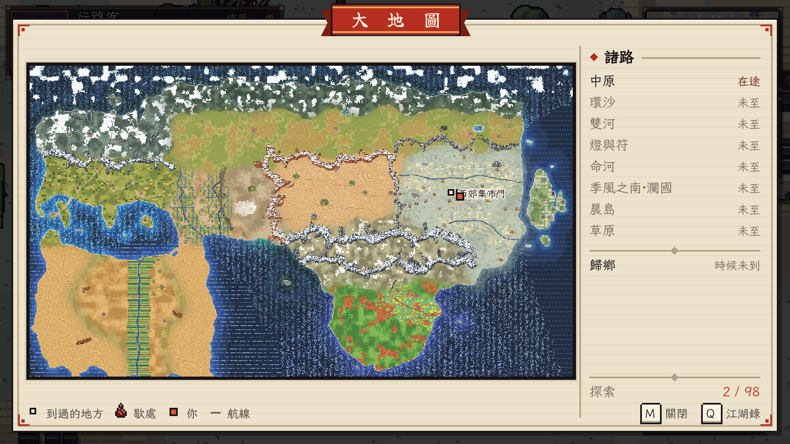
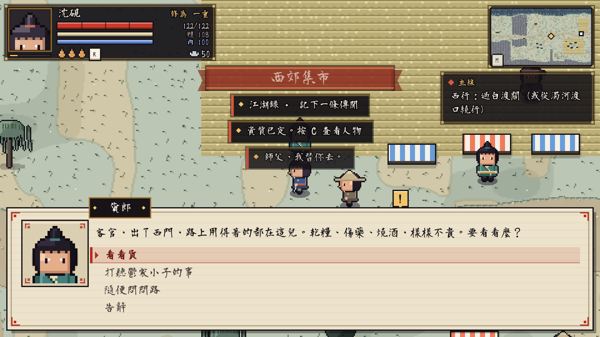
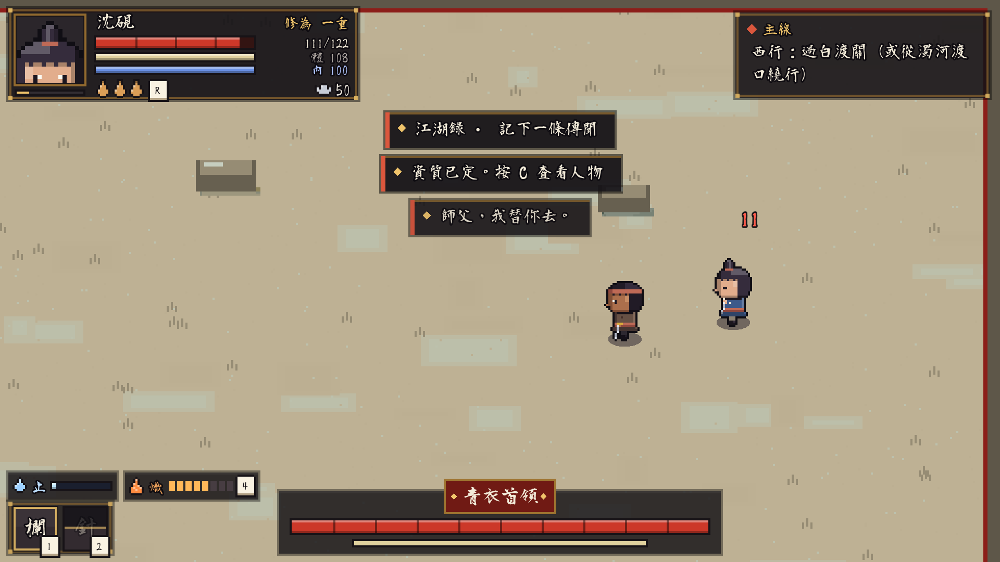
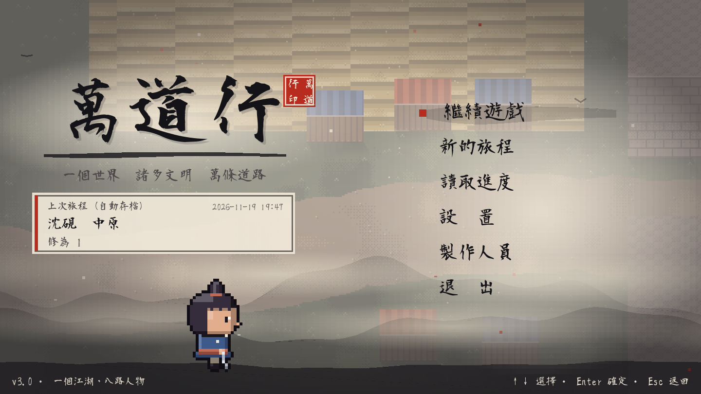

# 萬道行 Wandaoxing

A wuxia action RPG for macOS and Windows, set in one open world of many civilizations.

- **One world.** Walk a single great map, from the ink-wash Heartland across the steppe, the Sea of Sand, the twin rivers, the Inner Sea, the Life River, the monsoon South and the Dawn Isles. Enter towns, sect gates, temples and ports, and take boats between the coasts.
- **Eight culture lines, in any order.** Each land has its own story and people. Take them up as you arrive and leave them when you like. The world remembers what you did, and the homecoming waits until every road is walked.
- **No arrows.** You learn where to go from rumours (傳聞) heard from townsfolk, kept in your 江湖錄. If you want guidance back, a setting turns it on.
- **Real-time wuxia combat.** Dodge-centred fights on a separate battlefield. Every martial art has its own combo chains, palm follow-ups and techniques, with elements and resistances that differ by culture.
- **繁體中文 · English · 简体中文**, set in brush calligraphy.

This repository holds the downloadable releases only.

## Download

- **[⬇ macOS](https://github.com/142857bbcc-hub/Civilization_Legend-releases/releases/latest/download/Wandaoxing-mac.zip)**
- **[⬇ Windows](https://github.com/142857bbcc-hub/Civilization_Legend-releases/releases/latest/download/Wandaoxing-windows.zip)**

These links always give the newest version. Earlier versions and release notes are on the [Releases page](https://github.com/142857bbcc-hub/Civilization_Legend-releases/releases).

## Run

- **macOS:** unzip, then drag **萬道行 Wandaoxing.app** to Applications. The first time, right-click the app and choose **Open**: the game is not signed, so macOS asks once.
- **Windows:** unzip and run **Wandaoxing.exe**. If SmartScreen warns you, choose **More info → Run anyway**.

## Controls

Keyboard, mouse or controller. Every key can be rebound in the pause menu under 按鍵設置.

| Key | Action |
| --- | --- |
| `W A S D` / arrows | move |
| `Enter` / `F` | talk, examine, enter a place, confirm |
| `Space` / `Shift` | dodge |
| `J` / left click | light attack (chain it for combos) |
| `K` / right click | heavy attack (hold to charge) |
| `L` / middle click | palm: mid-combo it fires your palm art's follow-up |
| `1`–`5` | techniques |
| `Tab` | lock on |
| `R` | wound salve |
| `C` · `I` · `P` · `Q` · `M` | character · bag · martial arts · 江湖錄 · map |
| `H` / `F1` | controls |
| `Esc` | menu |

## Saving

The game saves by itself: at shrines, at turns in the story, and every minute when it is quiet. Rest at a shrine (歇處) to heal and set where you wake if you fall, and travel (行路) between any shrines you have found. Each new game is its own journey. **讀取進度** lists them all, and you can delete one there with `⌫`/`Del`.

Saves and settings are kept on your own computer, in `~/Library/Application Support/Godot/app_userdata/万道行 Wandaoxing/` on macOS and `%APPDATA%\Godot\app_userdata\万道行 Wandaoxing\` on Windows. The game never connects to the internet.

